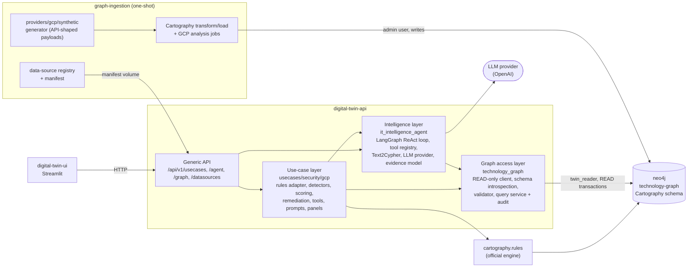

# Architecture

Enterprise IT Digital Twin is a cross-domain IT intelligence platform built on a technology knowledge graph.
POC 01, *Cloud Security Investigation - Google Cloud*, is the first registered use case.

## Layers, services and data flow

Dependency direction: use cases -> platform (agent, graph access) -> graph. Nothing in `core`,
`technology_graph`, `it_intelligence_agent`, `api` or `models` imports a use case or names a provider; a test
(`tests/test_platform_neutrality.py`) scans those packages for provider and security vocabulary.

| Layer | Package | Owns |
|---|---|---|
| Ingestion | `ingestion/graph_ingestion`, `ingestion/providers/gcp/synthetic` | data-source registry, manifest, read-only user bootstrap, synthetic generator + loader |
| Graph access | `backend/app/technology_graph` | driver, READ sessions, limits, schema introspection, validation, audited execution |
| Intelligence | `backend/app/it_intelligence_agent` | agent loop and ceilings, tool registry, platform tools, Text2Cypher, LLM provider, evidence model |
| Use case | `backend/app/usecases/security/gcp` | rules adapter, scenario detectors, scoring weights, remediation, tools, prompts, UI panel providers |

## Services

| Service | Role | Exposed |
|---|---|---|
| `credentials-init` | generates Neo4j credentials into the `secrets` volume, exits 0 | - |
| `neo4j` | Neo4j 5.26 Community, auth on, persistent volume | `127.0.0.1:7474`, `127.0.0.1:7687` |
| `graph-ingestion` | creates `twin_reader`, seeds the graph, writes the manifest, exits 0 | - |
| `digital-twin-api` | FastAPI | `127.0.0.1:8000` (`/docs`) |
| `digital-twin-ui` | Streamlit | `127.0.0.1:8501` |

`depends_on` chains them: credentials -> neo4j (healthy) -> ingestion (completed) -> API (healthy) -> UI.

## Registries (extension points, one implementation each)

- **Use-case registry** (`usecases/registry.py`): id, title, domain, provider, required node labels, agent tools,
  scoring profile, UI panels, prompt, few-shot examples, synonyms, startup hook. Installed packages are listed in
  `usecases/installed.py`. The API and UI enumerate it.
- **Agent tool registry** (`it_intelligence_agent/tools.py`): name, description, JSON input schema, output schema,
  owner. `get_graph_schema` and `execute_readonly_cypher` belong to the platform; `run_security_rules`,
  `get_resource_context`, `investigate_exposure`, `compare_remediation_options` to the GCP use case.
- **Data-source registry** (`ingestion/graph_ingestion/registry.py`): provider id, ingestion mode, loader,
  freshness root label, documented-but-unimplemented modes. Run metadata goes to a manifest file, never into the graph.
- **LLM provider** (`it_intelligence_agent/llm.py`): `ChatModelProvider` subclasses keyed by `LLM_PROVIDER`.

## Query safety (four layers)

1. **Server-side privileges**: dedicated `twin_reader` user; every transaction in READ access mode
   (Neo4j refuses writes with `Neo.ClientError.Statement.AccessMode`). See decision D-04 for Community Edition.
2. **Validation**: lexical denylist, procedure/function allowlist, server `EXPLAIN` (syntax, `query_type == "r"`,
   unknown labels/types/properties), check against the live schema.
3. **Execution limits**: per-query timeout (driver transaction timeout, plus `db.transaction.timeout` on the server),
   row cap, result-size cap, concurrency semaphore.
4. **Audit**: JSON lines in the `audit` volume: question, Cypher, verdict, reasons, outcome, duration, row count.
   No credentials.

## Investigation flow (POC 01)

1. `cartography.rules` facts run against the graph (only those the data can satisfy; the rest are listed with reasons).
2. A graph snapshot is read with a handful of use-case queries (validated at startup).
3. Detectors A-E combine rule findings with graph traversal; each finding carries evidence ids, graph paths,
   corroborating rule ids, missing evidence and a classification.
4. `scoring.py` computes the deterministic risk score; `remediation.py` builds options with operational impact
   computed from the graph (workloads per identity, instances per network).
5. The agent calls these through tools and explains; the UI renders the same data through generic panel kinds.

## Future live ingestion (`DATA_SOURCE=gcp`)

Documented, not implemented. In this mode `graph-ingestion` would run Cartography's own GCP module
(`cartography --selected-modules gcp ...`) against a real organisation, populating the same graph and schema, so
the platform, the rules adapter and the use case work unchanged.

Read-only identity for the collector (organisation level, granted to a dedicated service account):

| Role | Needed for |
|---|---|
| `roles/browser` or `roles/resourcemanager.folderViewer` + `roles/resourcemanager.organizationViewer` | org, folders, projects |
| `roles/iam.securityReviewer` | IAM policies, roles, service accounts |
| `roles/cloudasset.viewer` (+ `serviceusage.services.use` on the quota project) | policy bindings via Cloud Asset Inventory |
| `roles/compute.viewer` | instances, networks, firewalls |
| `roles/storage.objectViewer` is NOT needed; `roles/storage.legacyBucketReader` or `roles/viewer` metadata for buckets | buckets and bucket IAM |
| `roles/cloudsql.viewer` | Cloud SQL instances |

Configuration: credentials through Application Default Credentials (workload identity or a key file mounted
read-only, never committed), `--gcp-permission-relationships-file` pointing at the packaged mapping, and an
`--update-tag` per run. Cartography's cleanup jobs then remove stale nodes, which the synthetic mode does not need.
The platform remains read-only towards GCP: Cartography only calls list/get APIs, and the API never calls GCP at all.
